## ✨ 前言

做设计或者写文章的朋友应该都有过类似的烦恼：辛辛苦苦做完一个界面，结果放到文章里或者 PPT 里，一张“裸截图”怎么看怎么没有质感。别人看了，第一反应是——“嗯，就是一张截图”，完全感受不到作品的用心。

最近我发现了一个超好用的在线工具 —— [**Shots.so**](https://shots.so/)。它可以让普通截图瞬间变成高大上的效果图，不管是放在作品集、宣传图，还是发朋友圈/公众号，效果都特别加分。

## 💡 它能做什么？

简单来说，Shots.so 就是一个在线的 **mockup（效果图）生成器**：

-   你只需要上传一张截图，它就能帮你放进 iPhone、MacBook 等各种设备框架里；
    
-   还能加上渐变背景、阴影、动画、甚至视频效果；
    
-   最后直接导出高清图片，拿来做宣传图完全没问题。
    

整个过程全程拖拽 + 点点按钮，不需要 PS 基础，完全就是“傻瓜式”的操作。

## 🎯 适合哪些场景？

-   **UI/UX 设计师**：展示 App 界面或网页效果，放进设备 mockup 里瞬间专业感拉满。
    
-   **写博客/公众号的作者**：截图放进去，就比单纯贴个图更美观。
    
-   **做产品宣传**：公司官网、社交媒体、Pitch Deck，都能快速生成有质感的展示图。
    
-   **个人作品集**：不管你是设计师还是开发者，作品集页面用了 Shots.so，整体感觉会更“高级”。
    

## 🎨 功能亮点

### 📱 多设备 Mockup 模板

Shots.so 提供了丰富的设备外框，比如 **iPhone、iPad、MacBook、浏览器窗口** 等。只需上传截图，就能一键嵌入设备里，立刻让设计看起来更专业。

**浏览器窗口**

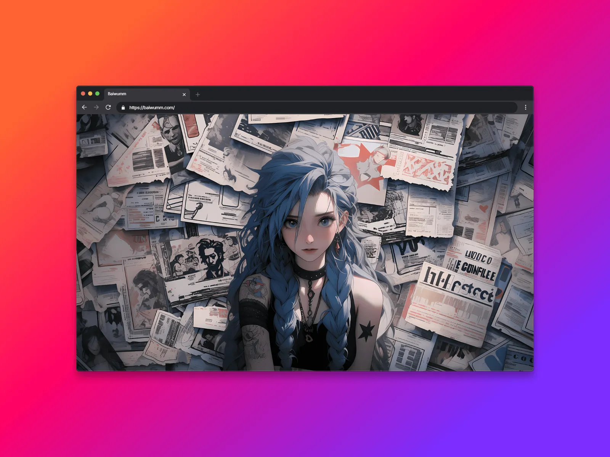

**iPhone 16 Plus**

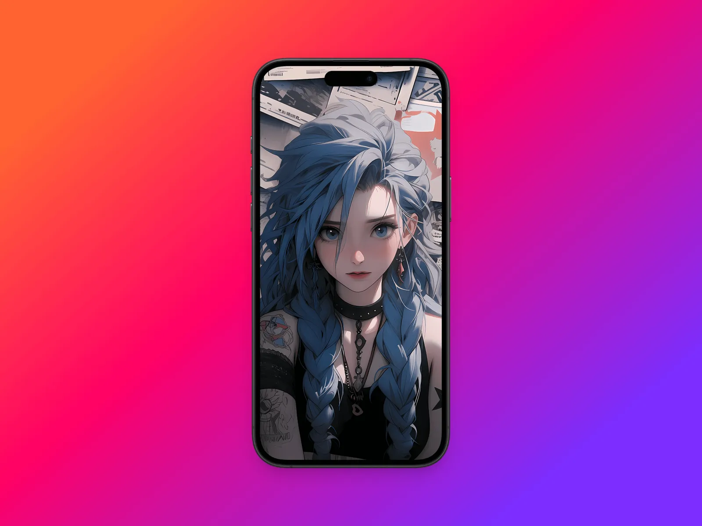

**MacBook Pro 16**

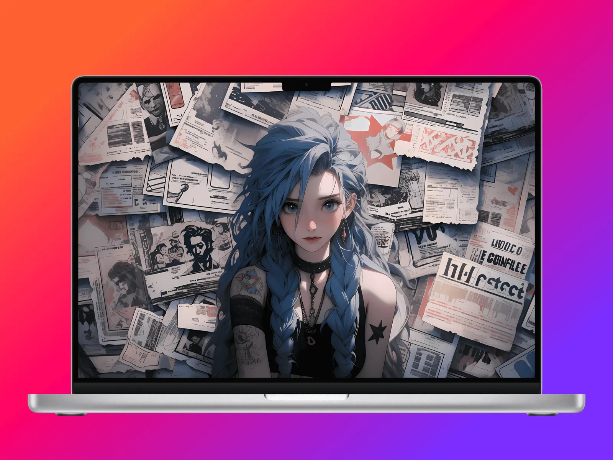

**Apple Watch Ultra**

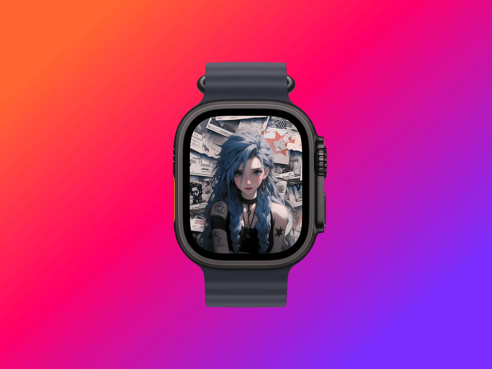

### 🎨 多样化背景与风格

除了设备框，Shots.so 还能快速设置背景：

-   **纯色 / 渐变色背景**
    
-   **虚化 / 阴影效果**
    
-   **创意特效（如霓虹、VHS、Glitch 故障风）**
    

这些效果能让截图的氛围和调性，和文章/产品宣传更贴合。

p]:my-0 [&>p>img]:my-0">

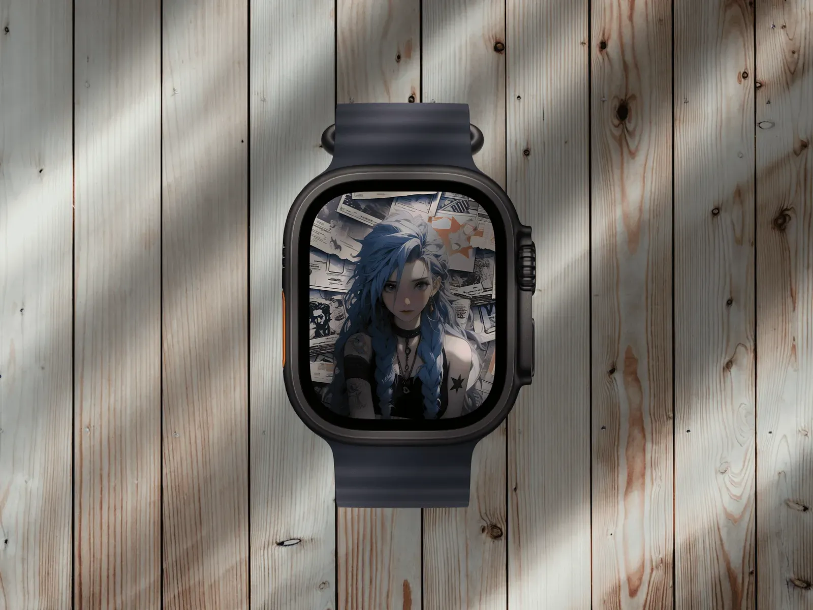

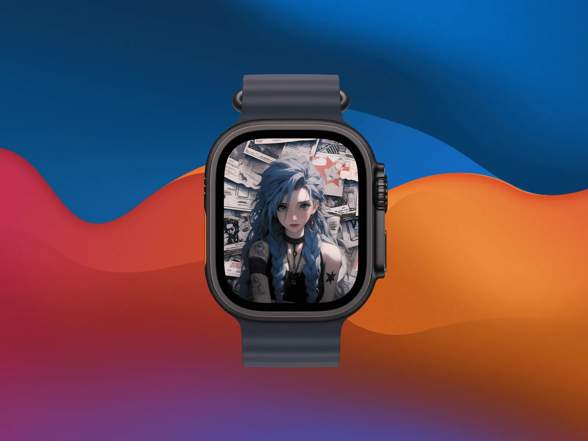

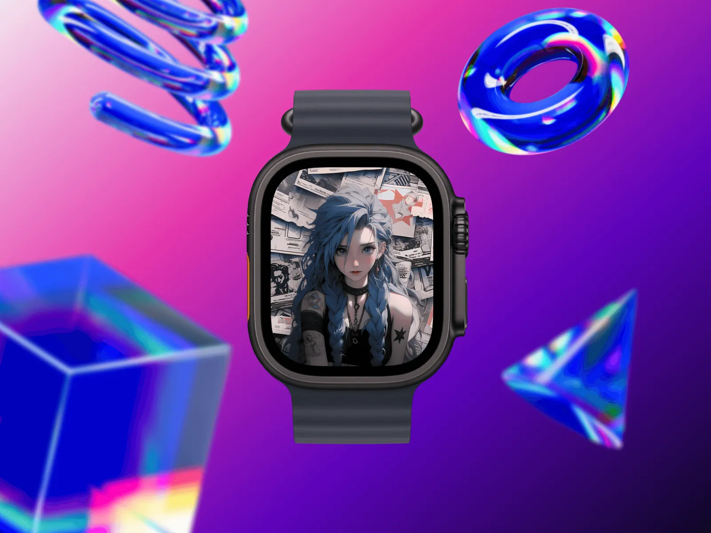

### 🖼️ 多图片样式展示

一个截图有时难以完整表达产品特性。Shots.so 贴心地提供了 **多图片布局样式**：

-   单图展示，突出重点
    
-   双图并列，适合对比说明
    
-   多图拼贴，展示一个系列或多功能场景
    

这种方式尤其适合展示 **App 的多个界面、网站的不同模块**，读者一眼就能看到全貌，而不是来回切图。

p]:my-0 [&>p>img]:my-0">

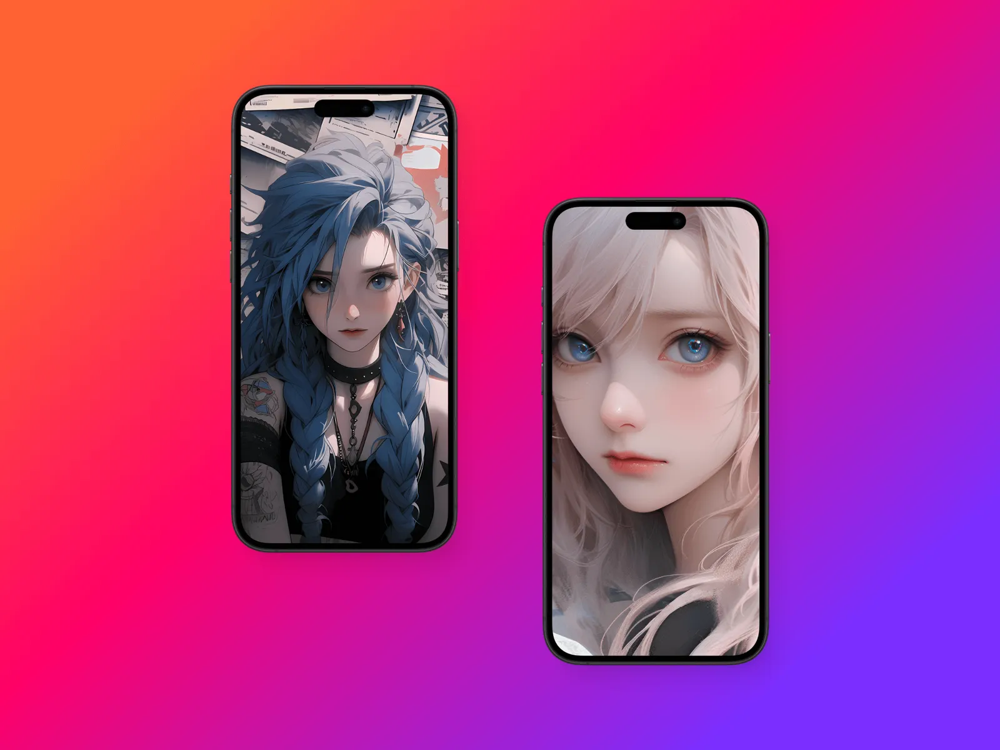

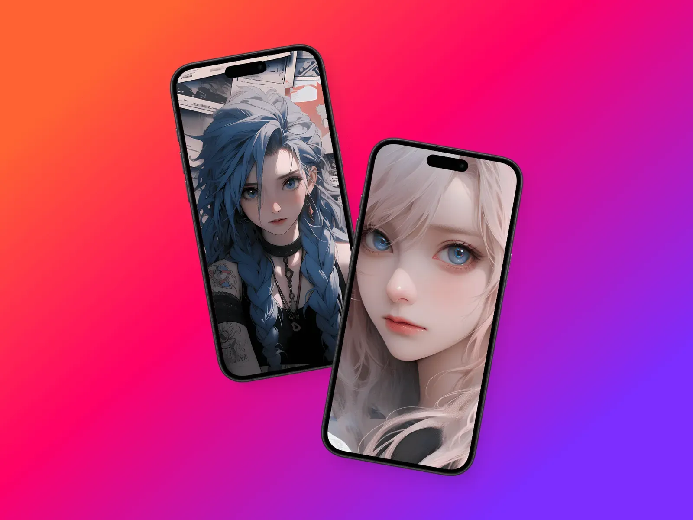

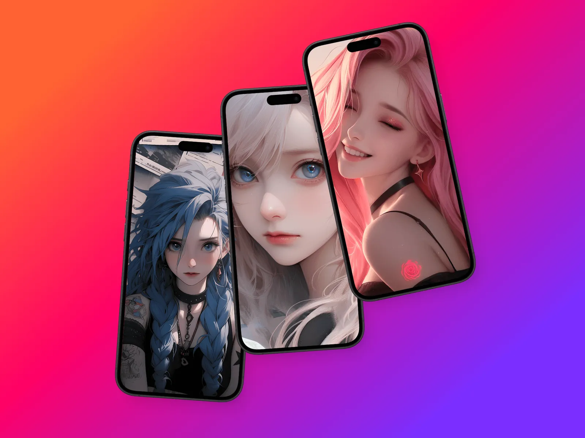

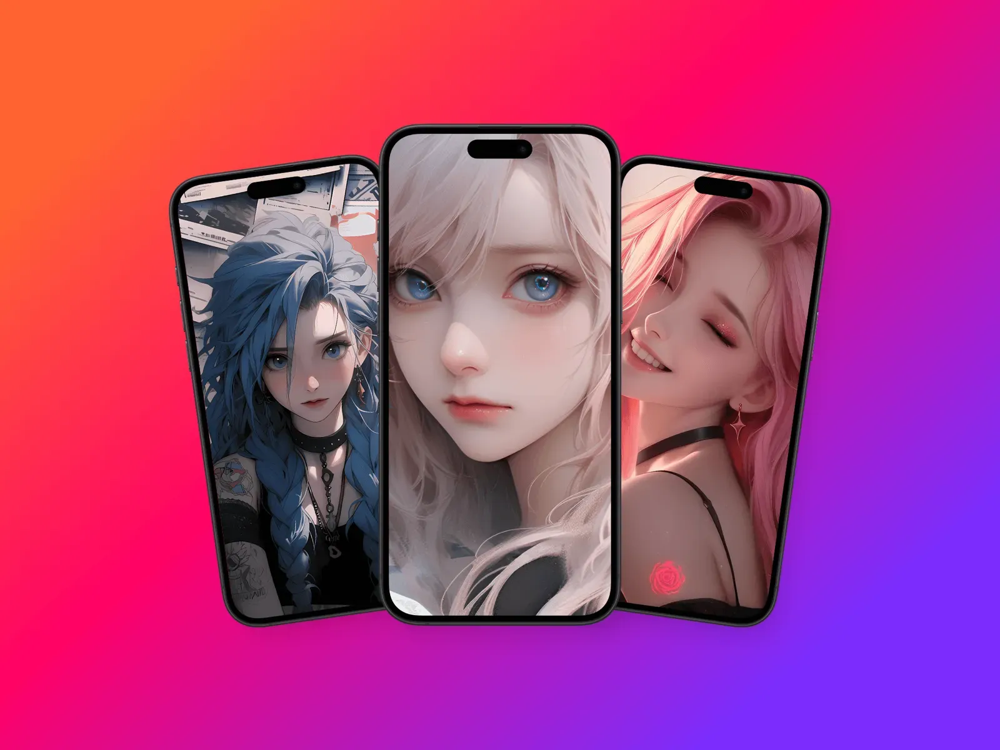

### 🎬 动画与视频支持

Shots.so 不仅能生成静态图片，还可以把截图做成 **动态展示**。比如：

-   模拟手机屏幕的滚动效果
    
-   视频界面展示
    
-   带过渡动画的产品演示
    

这样生成的文件非常适合 **官网展示** 或 **社交媒体宣传**。

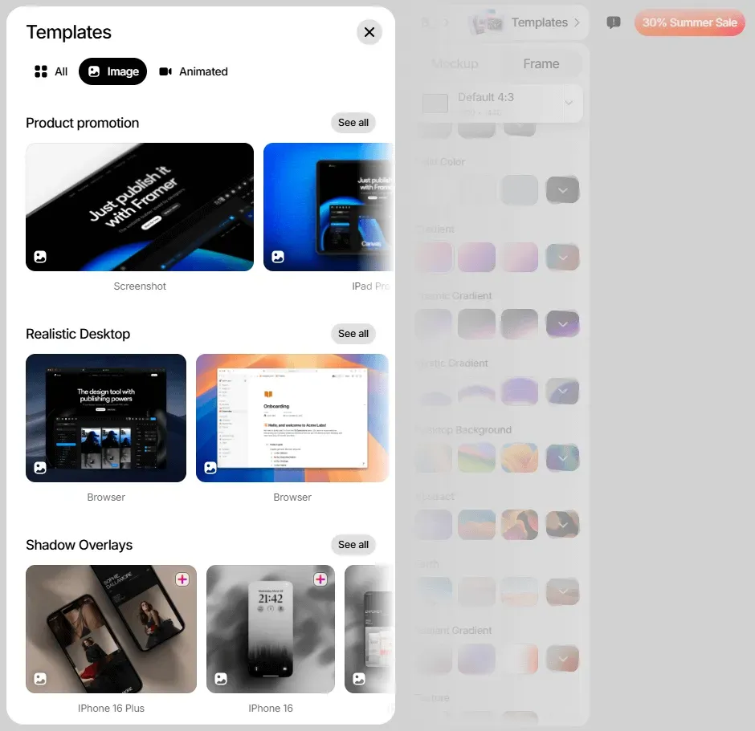

### 📤 一键导出与适配

最后生成的 mockup，可以一键导出为 **PNG / MP4 / GIF**，还贴心提供了 **不同平台的尺寸模板**：

-   Twitter / Instagram / LinkedIn 卡片尺寸
    
-   PPT、宣传海报常用比例
    

对于做营销、做作品集的同学来说，非常省心。

## 🖊️ 使用体验

我第一次用的时候，大概 2 分钟就搞定了一张看起来很“贵”的宣传图：上传截图 → 选一个 MacBook mockup → 加个渐变背景 → 导出 PNG，整个流程完全无痛，比自己用 PS 套模板快太多了。

对于没有设计基础的人来说，Shots.so 就像一个随手可用的“锦上添花”工具；而对于设计师，它可以大大节省重复劳动时间。

## 📝 总结

Shots.so 的定位就是“让展示更简单”。它把设计展示里那些琐碎的操作全部简化，只留给你最直观的结果。

无论你是：

-   设计师，要快速生成作品集展示图；
    
-   产品经理，要做演示或宣传素材；
    
-   内容创作者，要提升文章截图质感；
    

Shots.so 都能帮你省下不少时间，还能让作品看起来更专业。

在内容为王的时代，**作品的展示方式本身也是作品的一部分**。Shots.so 就像一块滤镜，让你的设计和创作更有质感。

如果你也经常需要展示截图，不妨试试看。也许下一次，你的作品就会因为一个好看的 mockup，多收获一些赞和关注。

👉 有兴趣的朋友可以直接体验：[Shots - Create Amazing Mockups](https://shots.so/)
