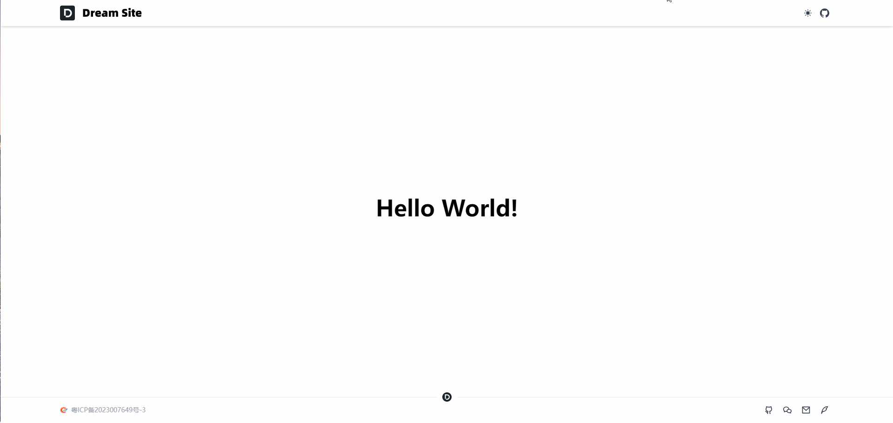

## 前言

今天开发项目的 **Footer** 布局，这里我们参考 [Nuxt-UI](https://ui.nuxt.com/) 官网的布局。

## 需求拆分

1.  准备好域名备案号和 **icp** 图标
    
2.  底部社交按钮链接或其他链接
    
3.  **AppFooter** 组件开发
    

## Footer 布局

1.  新建 **components/AppFooter.vue** 文件：
```vue
<template>
  <footer class="fixed bottom-0 w-full">
    <UDivider :avatar="{ src: '/logo.svg' }" />
    <div class="flex justify-between items-center px-4 md:px-8 lg:px-32 py-3 max-sm:flex-col -mt-2.5">
      <!-- icp 备案 -->
      <ULink
        to="https://beian.miit.gov.cn/#/Integrated/index"
        target="_blank"
        active-class="text-primary"
        inactive-class="text-sm text-gray-400 hover:text-gray-600 dark:hover:text-gray-300"
      >
        <div class="flex items-center gap-2">
          <NuxtImg
            src="/icp.png"
            alt="粤ICP备2023007649号-3"
            class="w-4"
          />
          粤ICP备2023007649号-3
        </div>
      </ULink>
      <!-- 社交图标 -->
      <div class="max-sm:order-first">
        <!-- github -->
        <SocialButton
          icon="i-ri-github-line"
          url="https://github.com/baiwumm"
          tip="Github"
        />
        <!-- 微信 -->
        <SocialButton
          icon="i-ri-wechat-line"
          url="https://wechat.baiwumm.com/"
          tip="微信"
        />
        <!-- 电子邮箱 -->
        <SocialButton
          icon="i-ri-mail-line"
          url="mailto:baiwumm@foxmail.com"
          tip="Email"
        />
        <!-- 博客 -->
        <SocialButton
          icon="i-ri-quill-pen-line"
          url="https://baiwumm.com"
          tip="博客"
        />
      </div>
    </div>
  </footer>
 </template>
```


2.  **layouts/default.vue** 文件配置组件：
```vue
<template>
  <div>
    <!-- header -->
    <AppHeader />
    <!-- main -->
    <slot />
    <!-- footer -->
    <AppFooter />
  </div>
 </template>
```


3.  这里我们顺便给 **AppColorMode** 组件加个切换过渡动画，让网站丰富一点：
```vue
<script setup lang="ts">
const colorMode = useColorMode()

// 切换模式
const setColorMode = () => {
  colorMode.value = colorMode.value === 'dark' ? 'light' : 'dark'
}

// 判断是否支持 startViewTransition API
const enableTransitions = () =>
  'startViewTransition' in document &&
  window.matchMedia('(prefers-reduced-motion: no-preference)').matches

// 切换动画
async function toggleDark({ clientX: x, clientY: y }: MouseEvent) {
  const isDark = colorMode.value === 'dark'

  if (!enableTransitions()) {
    setColorMode()
    return
  }

  const clipPath = [
    `circle(0px at ${x}px ${y}px)`,
    `circle(${Math.hypot(
      Math.max(x, innerWidth - x),
      Math.max(y, innerHeight - y)
    )}px at ${x}px ${y}px)`
  ]

  await document.startViewTransition(async () => {
    setColorMode()
    await nextTick()
  }).ready

  document.documentElement.animate(
    { clipPath: !isDark ? clipPath.reverse() : clipPath },
    {
      duration: 300,
      easing: 'ease-in',
      pseudoElement: `::view-transition-${!isDark ? 'old' : 'new'}(root)`
    }
  )
}
</script>

<template>
  <UTooltip :text="`切换${$colorMode.value === 'dark' ? '白天' : '黑夜'}模式`">
    <UButton
      :icon="$colorMode.value === 'dark' ? 'i-heroicons-moon-solid' : ' i-heroicons-sun-solid'"
      size="sm"
      variant="ghost"
      class="text-gray-700 dark:text-gray-200 hover:text-gray-900 dark:hover:text-white hover:bg-gray-50 dark:hover:bg-gray-800"
      @click="toggleDark"
    />
  </UTooltip>
</template>

<style>
::view-transition-old(root),
::view-transition-new(root) {
  animation: none;
  mix-blend-mode: normal;
}

::view-transition-old(root),
.dark::view-transition-new(root) {
  z-index: 1;
}

::view-transition-new(root),
.dark::view-transition-old(root) {
  z-index: 9999;
}
</style>
```


## 最终效果



## 总结

这个篇章内容比较简单，下一篇开发主体内容。

好了，今天就到这吧！

**Github 仓库**：[Better Nav](https://github.com/baiwumm/better-nav)

**线上预览**：[一个把常用网址收拾得干干净净的小站](https://nav.baiwumm.com/)
