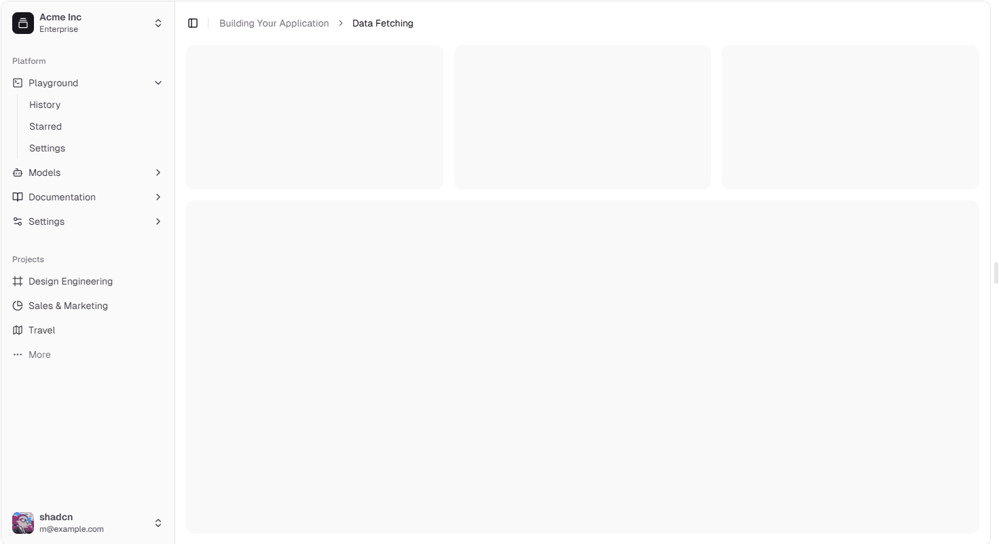
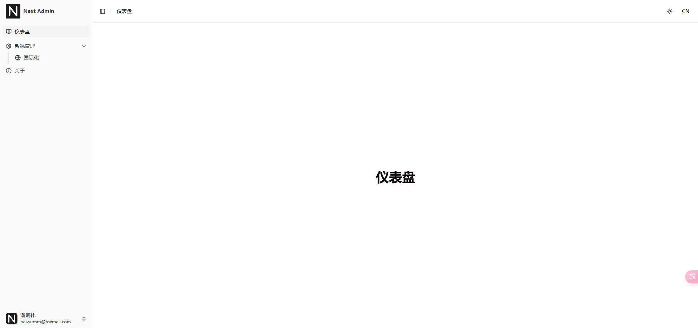

## 前言

等了许久，[Next.js](https://nextjs.org/) 终于迎来了**v15.x**版本，刚好[Github](https://github.com/baiwumm)上面的旧项目重构完，终于可以放心大胆地去研究[Next.js](https://nextjs.org/)了。

搭建最新项目可以参考官方文档：

::link-card[https://nextjs.org/docs/app/getting-started/installation]

> 最新的[Next.js](https://nextjs.org/)版本，使用的是[React19.x](https://react.dev/)内测版本，可能存在与其他库不兼容的情况

## 项目开发规范配置

这块内容我都懒得写了，具体的可以参考我之前写的文章，配置大同小异：

::link-card[/posts/hnc96th6]

## UI 组件库的选择

1.  [NextUI](https://nextui.org/)：我个人是比较喜欢[NextUI](https://nextui.org/)的，这个库的**UI**设计比较符合我的审美，而且我之前的项目[今日热榜](https://hot.baiwumm.com/)中用的就是这个，感觉还不错，但我仔细看了下，它缺少了一个很重要的组件：**Form表单**，这个会给后面频繁的**CURD**表单操作带来麻烦，所以放弃了

2.  [Ant-Design](https://ant-design.antgroup.com/)：[Ant-Design](https://ant-design.antgroup.com/)是我再熟悉不过的组件库了，公司的业务用的就是这个，但这个库还是有点偏业务风格，而且目前和[Next.js](https://nextjs.org/)的兼容性还存在点问题，自己也有点审美疲劳了，也放弃了。

3.  [shadcn/ui](https://www.shadcn-ui.cn/)：最终选择了这个，这个库是基于[tailwindcss](https://www.tailwindcss.cn/)的，而且目前在市场上很受欢迎，[Github](https://github.com/shadcn-ui/ui)也保持不错的增长，而且是你想用什么组件，就把组件源码直接放到应用程序中的，值得推荐。

## layout 排版布局

我们先搞定最常规的布局，[shadcn/ui](https://www.shadcn-ui.cn/)的[构建块](https://www.shadcn-ui.cn/blocks)中有一些常规的布局，我一下就看重这个：



1.  左侧是[slibar](https://www.shadcn-ui.cn/docs/components/sidebar)，菜单顶部可以放 **Logo** 和标题

2.  右侧顶部放用户头像和一些操作按钮，比如：面包屑、暗黑模式、全屏、消息通知等

3.  中间就是业务模块，底部放版权信息

## 业务代码

1.  新增 **src/components/AppSideBar/index.tsx** 文件：

```ts
'use client';

import Image from 'next/image';
import * as React from 'react';

import NavMain from '@/components/NavMain';
import NavUser from '@/components/NavUser';
import {
  Sidebar,
  SidebarContent,
  SidebarFooter,
  SidebarHeader,
  SidebarMenu,
  SidebarMenuButton,
  SidebarMenuItem,
} from '@/components/ui/sidebar';

const data = {
  user: {
    name: '谢明伟',
    email: 'baiwumm@foxmail.com',
    avatar: 'logo.svg',
  },
};

export default function AppSideBar({ ...props }: React.ComponentProps<typeof Sidebar>) {
  return (
    <Sidebar collapsible="icon" {...props}>
      <SidebarHeader>
        <SidebarMenu>
          <SidebarMenuItem>
            <SidebarMenuButton size="lg" asChild>
              <div className="flex items-center gap-2 cursor-pointer">
                <Image src="/logo.svg" width={40} height={40} alt="logo" />
                <span className="truncate font-semibold">{process.env.NEXT_PUBLIC_PROJECT_NAME}</span>
              </div>
            </SidebarMenuButton>
          </SidebarMenuItem>
        </SidebarMenu>
      </SidebarHeader>
      <SidebarContent>
        <NavMain />
      </SidebarContent>
      <SidebarFooter>
        <NavUser user={data.user} />
      </SidebarFooter>
    </Sidebar>
  );
}
```

2.  新增 **src/components/NavMain/index.tsx** 文件：

```ts
'use client';

import { map } from 'lodash-es';
import { ChevronRight } from 'lucide-react';
import { usePathname, useRouter } from 'next/navigation';
import { useTranslations } from 'next-intl';
import { useState } from 'react';

import { Collapsible, CollapsibleContent, CollapsibleTrigger } from '@/components/ui/collapsible';
import {
  SidebarGroup,
  SidebarMenu,
  SidebarMenuButton,
  SidebarMenuItem,
  SidebarMenuSub,
  SidebarMenuSubButton,
  SidebarMenuSubItem,
} from '@/components/ui/sidebar';
import MenuList from '@/constants/MenuList';

export default function NavMain() {
  const t = useTranslations('Route');
  // 路由跳转
  const router = useRouter();
  // 当前激活的菜单
  const pathname = usePathname();
  const [activeKey, setActiveKey] = useState(pathname);

  // 点击菜单回调
  const handleMenuClick = (path: string, redirect = '') => {
    if (redirect) {
      return;
    }
    router.push(path);
    setActiveKey(path);
  };
  return (
    <SidebarGroup>
      <SidebarMenu>
        {map(MenuList, ({ path, icon, name, redirect, children = [] }) => (
          <Collapsible key={path} asChild defaultOpen={activeKey === path} className="group/collapsible">
            <SidebarMenuItem>
              <CollapsibleTrigger asChild>
                <SidebarMenuButton
                  tooltip={t(name)}
                  isActive={activeKey === path}
                  onClick={() => handleMenuClick(path, redirect)}
                >
                  {icon}
                  <span>{t(name)}</span>
                  {children?.length ? (
                    <ChevronRight className="ml-auto transition-transform duration-200 group-data-[state=open]/collapsible:rotate-90" />
                  ) : null}
                </SidebarMenuButton>
              </CollapsibleTrigger>
              <CollapsibleContent>
                <SidebarMenuSub>
                  {map(children, (subItem) => (
                    <SidebarMenuSubItem key={subItem.path}>
                      <SidebarMenuSubButton asChild onClick={() => handleMenuClick(subItem.path, subItem.redirect)}>
                        <a onClick={() => handleMenuClick(path, redirect)} className="cursor-pointer">
                          {subItem.icon}
                          <span>{t(subItem.name)}</span>
                        </a>
                      </SidebarMenuSubButton>
                    </SidebarMenuSubItem>
                  ))}
                </SidebarMenuSub>
              </CollapsibleContent>
            </SidebarMenuItem>
          </Collapsible>
        ))}
      </SidebarMenu>
    </SidebarGroup>
  );
}
```

3.  新增 **src/components/NavUser/index.tsx** 文件：

```ts
'use client';

import { ChevronsUpDown, IdCard, LogOut } from 'lucide-react';

import { Avatar, AvatarFallback, AvatarImage } from '@/components/ui/avatar';
import {
  DropdownMenu,
  DropdownMenuContent,
  DropdownMenuGroup,
  DropdownMenuItem,
  DropdownMenuLabel,
  DropdownMenuSeparator,
  DropdownMenuTrigger,
} from '@/components/ui/dropdown-menu';
import { SidebarMenu, SidebarMenuButton, SidebarMenuItem, useSidebar } from '@/components/ui/sidebar';

export default function NavUser({
  user,
}: {
  user: {
    name: string;
    email: string;
    avatar: string;
  };
}) {
  const { isMobile } = useSidebar();

  return (
    <SidebarMenu>
      <SidebarMenuItem>
        <DropdownMenu>
          <DropdownMenuTrigger asChild>
            <SidebarMenuButton
              size="lg"
              className="data-[state=open]:bg-sidebar-accent data-[state=open]:text-sidebar-accent-foreground"
            >
              <Avatar className="h-8 w-8 rounded-lg">
                <AvatarImage src={`/${user.avatar}`} alt={user.name} />
                <AvatarFallback className="rounded-lg">CN</AvatarFallback>
              </Avatar>
              <div className="grid flex-1 text-left text-sm leading-tight">
                <span className="truncate font-semibold">{user.name}</span>
                <span className="truncate text-xs">{user.email}</span>
              </div>
              <ChevronsUpDown className="ml-auto size-4" />
            </SidebarMenuButton>
          </DropdownMenuTrigger>
          <DropdownMenuContent
            className="w-[--radix-dropdown-menu-trigger-width] min-w-56 rounded-lg"
            side={isMobile ? 'bottom' : 'right'}
            align="end"
            sideOffset={4}
          >
            <DropdownMenuLabel className="p-0 font-normal">
              <div className="flex items-center gap-2 px-1 py-1.5 text-left text-sm">
                <Avatar className="h-8 w-8 rounded-lg">
                  <AvatarImage src={`/${user.avatar}`} alt={user.name} />
                  <AvatarFallback className="rounded-lg">CN</AvatarFallback>
                </Avatar>
                <div className="grid flex-1 text-left text-sm leading-tight">
                  <span className="truncate font-semibold">{user.name}</span>
                  <span className="truncate text-xs">{user.email}</span>
                </div>
              </div>
            </DropdownMenuLabel>
            <DropdownMenuSeparator />
            <DropdownMenuGroup>
              <DropdownMenuItem>
                <IdCard />
                个人中心
              </DropdownMenuItem>
            </DropdownMenuGroup>
            <DropdownMenuSeparator />
            <DropdownMenuItem>
              <LogOut />
              退出登录
            </DropdownMenuItem>
          </DropdownMenuContent>
        </DropdownMenu>
      </SidebarMenuItem>
    </SidebarMenu>
  );
}
```

4.  新增 **src/components/GlobalHeader/index.tsx** 文件：

```ts
'use client';

import { compact, map } from 'lodash-es';
import { usePathname } from 'next/navigation';
import { useTranslations } from 'next-intl';
import { Fragment } from 'react';

import LangSwitch from '@/components/LangSwitch';
import ThemeModeButton from '@/components/ThemeModeButton';
import {
  Breadcrumb,
  BreadcrumbItem,
  BreadcrumbList,
  BreadcrumbPage,
  BreadcrumbSeparator,
} from '@/components/ui/breadcrumb';
import { Separator } from '@/components/ui/separator';
import { SidebarTrigger } from '@/components/ui/sidebar';

export default function GlobalHeader() {
  const t = useTranslations('Route');
  const pathname = usePathname();
  const splitPath = compact(pathname.split('/'));
  return (
    <header className="flex h-16 shrink-0 items-center gap-2 transition-[width,height] ease-linear group-has-[[data-collapsible=icon]]/sidebar-wrapper:h-12 border-b justify-between px-4 sticky top-0">
      <div className="flex items-center gap-2">
        <SidebarTrigger className="-ml-1" />
        <Separator orientation="vertical" className="mr-2 h-4" />
        <Breadcrumb>
          <BreadcrumbList>
            {map(splitPath, (path, index) => (
              <Fragment key={path}>
                <BreadcrumbItem>
                  <BreadcrumbPage>{t(path)}</BreadcrumbPage>
                </BreadcrumbItem>
                {index < splitPath.length - 1 ? <BreadcrumbSeparator className="hidden md:block" /> : null}
              </Fragment>
            ))}
          </BreadcrumbList>
        </Breadcrumb>
      </div>
      <div className="flex gap-2">
        <ThemeModeButton />
        <LangSwitch />
      </div>
    </header>
  );
}
```

5.  **App/layout.tsx**文件：

```ts
import AppSideBar from '@/components/AppSideBar';
import GlobalHeader from '@/components/GlobalHeader';
import { SidebarInset, SidebarProvider } from '@/components/ui/sidebar';

export default async function RootLayout({
children,
}: Readonly<{
children: React.ReactNode;
}>) {
return (
  <html suppressHydrationWarning>
    <body>
      <SidebarProvider>
        <AppSideBar />
        <SidebarInset>
          {/* 头部布局 */}
          <GlobalHeader />
          <main className="p-4">{children}</main>
        </SidebarInset>
      </SidebarProvider>
    </body>
  </html>
);
}
```

## 最终效果



万事开头难，后续我们就可以在此基础上新增功能、主题配置等，比如：侧边栏宽度、主题色、头部是否固定等

如果你也正在学习[Next.js](https://nextjs.org/)，关注我，我也刚起步，与我在互联网中共同进步！
