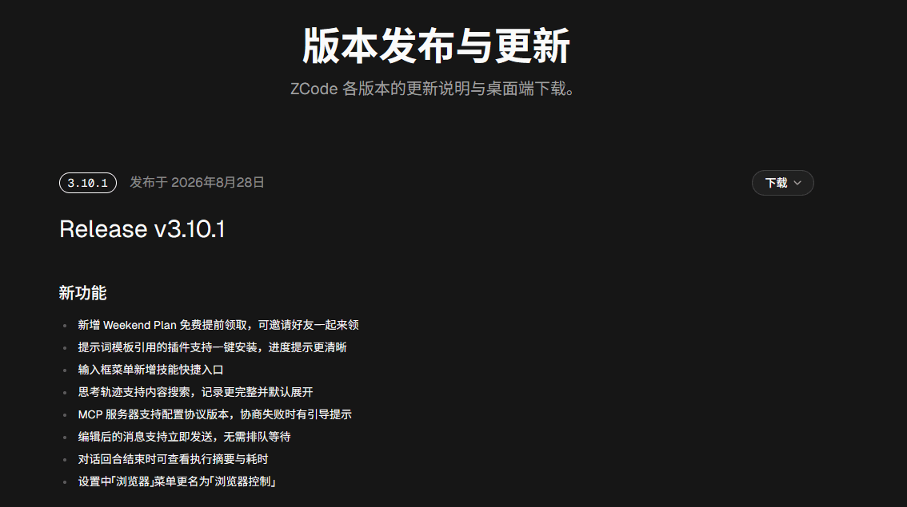
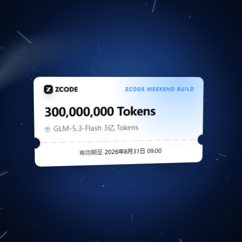
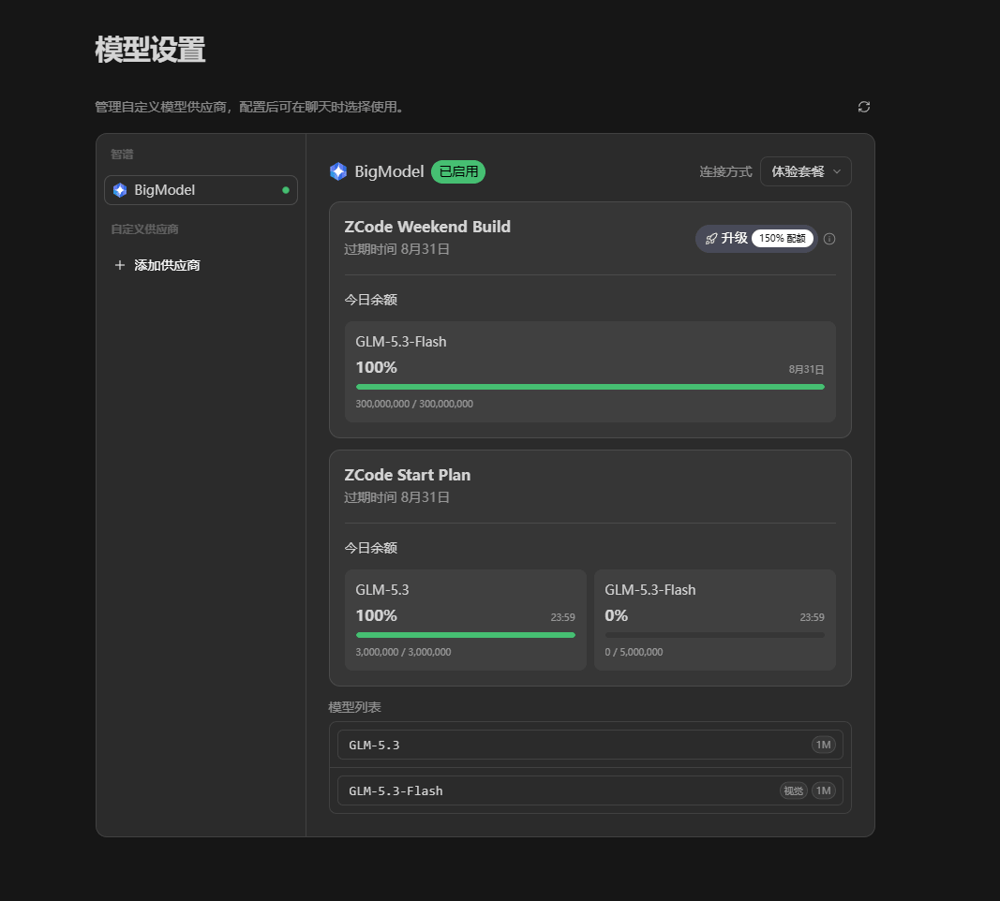
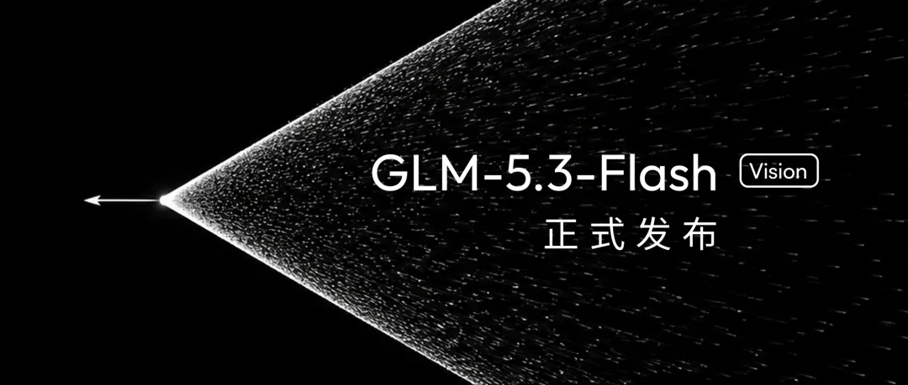

## 前言

智谱又撒币了。继上个月「1 亿 Token 免费送」上线一小时就被挤爆喊停之后，这周末 ZCode 把活动加码升级成了「周末送额度」：**3 亿 Token 免费领**，而且从一次性活动变成了每个周末的常态福利。

今天是周五，活动今晚 20:00 正式生效，趁着领到了额度，把活动规则和领取步骤整理成这篇文章，顺便聊聊这次活动的主角——GLM-5.3-Flash。

## 活动规则一览

先看最关键的信息：

| 项目 | 说明 |
| ---- | ---- |
| 领取时间 | 本周五 15:00 起开放领取 |
| 生效时间 | 领取当日 20:00（北京时间） |
| 到期时间 | 下周一 09:00 |
| 额度大小 | 3 亿 Token 体验额度 |
| 领取限制 | 每账号限领一次 |
| 参与对象 | 新用户、老用户、Coding Plan 订阅用户均可 |
| 支持模型 | 仅支持 GLM-5.3-Flash |

有几个点值得注意：

- **Coding Plan 订阅用户也能领**，且原有套餐权益不受影响，相当于白嫖叠加；
- 新老用户一视同仁，没注册过的朋友这周末入坑正合适；
- 额度仅限本人使用，**不可转让、出售或兑换现金**；
- 高峰期可能限流，官方优先保障付费用户；
- 「先到先得」的池子压力不小，上次 1 亿 Token 一小时被抢光的场面还历历在目，这周末的动作最好快一点。

## 三步领取

领取过程很简单，三步搞定。

### 第一步：升级 ZCode 至 3.10.0 或更高版本

打开客户端，在设置里检查更新，升级到 3.10.0 及以上版本。活动入口是这个版本才有的，旧版本看不到。还没装 ZCode 的，去官网 [zcode.z.ai](https://zcode.z.ai/cn) 下载。

顺带一提，3.10.1 的更新日志里还加了「Weekend Plan 免费提前领取」和邀请好友一起领的功能，如果版本有更新，直接升到最新即可。

### 第二步：登录 ZCode 账号

登录是判定领取资格的依据，没登录的话活动卡片不会出现。

### 第三步：左下角活动卡片点击「领取」

周五 15:00 起，客户端**左下角**会出现活动卡片，点击「领取」即可。额度不会立刻到账，而是**当日 20:00 统一生效**。

## 怎么用：切换「体验套餐」

领到的额度**仅限 ZCode 内使用**，默认不会自动启用，需要在「模型设置」里把套餐切换到「**体验套餐**」，之后跑任务消耗的就是这 3 亿 Token 了。

## 这次活动的主角：GLM-5.3-Flash

体验套餐支持的模型是 **GLM-5.3-Flash**，这是 GLM-5 系列首个原生多模态模型，值得单独说一下。

几个关键参数：

- **架构**：总参数量 320B，激活参数仅 18B，首次采用稀疏注意力 + 线性注意力的混合架构，显存压力大幅降低；
- **上下文**：100 万 Token 超长上下文，最大输出 128K，整库丢进去分析也不虚；
- **能力**：智能指数与 Claude Opus 4.8 持平，在编码与智能体基准上明显优于上一代 GLM-5.2，发布前曾以匿名代号「Ox Alpha」在 OpenCode 和 OpenRouter 上盲测；
- **价格**：官方定价输入 0.8 元 / 百万 Token、输出 2.8 元 / 百万 Token，大约是 Claude Opus 4.8 的 1/40。

官方头图上的那句「看得懂图像、视频与文档」就是它这次最主打的能力：原生多模态意味着它可以读懂截图、设计稿、视频和文档，配合 100 万上下文，扔一张 UI 截图让它复刻页面这类任务正好是它的主场。

另外在 ZCode 里，GLM-5.3-Flash 还可以搭配 **Browser Use** 和 **Computer Use** 使用，让模型直接操作浏览器和你的电脑完成任务，周末拿它跑一些「帮我整理桌面文件」「抓取某个页面数据」之类的智能体任务，正好把额度消耗在平时舍不得开的场景上。

## 几点使用建议

结合上次活动的经验和这次的规则，给几个建议：

1. **尽早领**。周五 15:00 卡片一出就点领取，晚高峰 20:00 生效后池子会消耗得很快。
2. **周末内用完**。额度下周一 09:00 到期，未使用的部分自动失效，不可延期、不可折现，3 亿 Token 攒着不动纯属浪费。
3. **轻任务优先走 Flash**。GLM-5.3-Flash 本身消耗系数更低（非高峰期 0.4 倍），把重活留给周末额度，日常轻量任务也能省出不少。
4. **对限流有心理预期**。高峰期可能限流，官方会优先保障付费用户，遇到排队别慌，换个时间段就好。

## 参考资料

- [ZCode 周末送额度活动开启：3 亿 Token 免费领取（官方公告原文）](https://mp.weixin.qq.com/s/PqMc1glHguIlzO73aKgh6A)
- [ZCode 官网](https://zcode.z.ai/cn)
- [ZCode 更新日志](https://zcode.z.ai/cn/changelog)
- [智谱开放平台：GLM-5.3-Flash 文档](https://docs.bigmodel.cn/cn/guide/models/vlm/glm-5.3-flash)
- [GLM-5.3-Flash 用量与计费说明](https://docs.bigmodel.cn/cn/coding-plan/notice/usage-revision)
